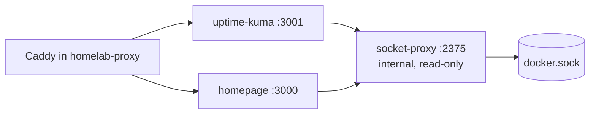

# lab-status

A private ops view of the lab Docker VM, behind
[homelab-proxy](../homelab-proxy):



*Diagram, not a capture: how requests reach the Docker socket. Only the socket
proxy touches the socket.*

<!-- doc-media TODO
Kind: Homepage, Uptime Kuma and LibreNMS screenshots. Purpose: show the app launcher and monitoring views.
Capture acceptance: use synthetic service names and status history, omit host addresses, personal app links and notification settings, record image versions and date.
Blocker: there is no demo or fixture mode, and this machine has no Docker or Podman to run the stack (Uptime Kuma builds from a fork image); live pages sit behind homelab-proxy's LAN/VPN allow-list and show private service names and internal URLs. A sanitized representative capture meeting the acceptance above has not been prepared.
-->

| Site | App | What it shows |
|---|---|---|
| `status.<LAB_DOMAIN>` | Uptime Kuma | up/down and uptime history of every site and container; Discord alerts |
| `librenms.<LAB_DOMAIN>` | LibreNMS | network availability, SNMP health, interface graphs, Discord and Pixel alerts |
| `home.<LAB_DOMAIN>` | Homepage | links to every lab app, live container status, CPU and memory, VM resources |

Only the socket proxy touches the Docker socket, and it allows nothing but
read-only container queries. No container publishes a port. Uptime Kuma keeps
its own login; Homepage is reachable only through homelab-proxy's LAN/VPN
allow-list.

[LibreNMS deployment and monitoring](docs/LIBRENMS.md) runs as a separate Compose project.

[Remote access with Tailscale](docs/TAILSCALE.md) is another separate project: a
userspace subnet router that gives tailnet devices Home Assistant, the lab sites
and split DNS, with no port forwarded.

AI Server, Hermes and ComfyUI Homepage links are deployed for VM103, with
Kuma monitors 27/28/29 enrolled on 2026-10-26. They have no Docker badges.
The [AI service entries](docs/deploy/ai-service-entries.md)
separate liveness/login/editor checks from real GPU and output acceptance.

## Deploy

On the VM, after homelab-proxy 0.3.0 or later:

```sh
cp .env.example .env
docker compose build uptime-kuma   # from the fork checkout: see docs/deploy/upgrade.md
docker compose up -d
```

Then follow the [deploy guide](docs/DEPLOY.md) for container names, Uptime Kuma's
first run, monitors, the alert test and backups.

## Test

```sh
node --test "test/*.test.js"
```

Node 20+ only. The version is in `VERSION` ([docs/VERSIONING.md](docs/VERSIONING.md)).

## Documentation

Start with the [documentation bundle](docs/index.md). Follow the
[OKF maintenance runbook](docs/OKF.md) when editing documentation.

| Topic | Page |
|---|---|
| Deploy on the VM | [Deploy on the lab VM](docs/DEPLOY.md) |
| Network monitoring | [LibreNMS](docs/LIBRENMS.md) |
| Remote access | [Tailscale](docs/TAILSCALE.md) |
| Releases | [Versioning](docs/VERSIONING.md) |
