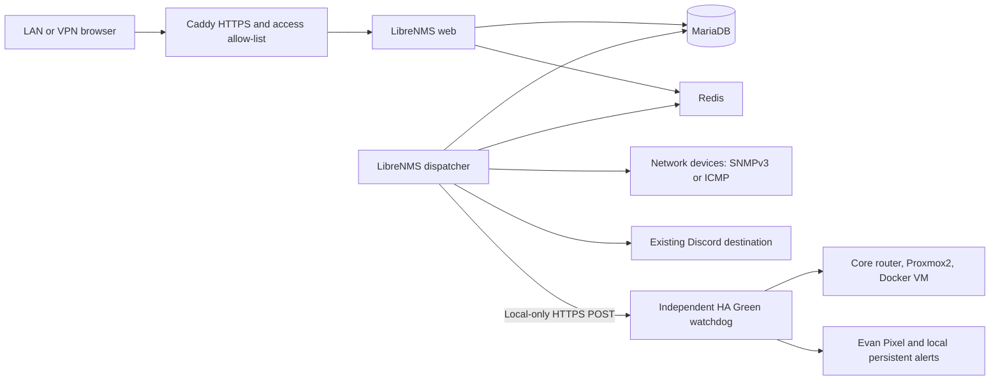

# Network monitoring with LibreNMS

Deployed 2026-10-25 on sfdockerhost1 (VM101, `10.8.30.29`). Open
[LibreNMS](https://librenms.lab.spiralfrenzy.com); your local admin username is
`evan`. The owner approved storing its generated password and SNMPv3 credentials
in the Git-ignored `homelab-infra/secrets/monitoring/credentials.json`:
`admin.username`, `admin.password`, `snmp.username`, `snmp.auth`, `snmp.privacy`.
The file ACL permits the owner and SYSTEM. Never paste values into commands,
documentation, tickets or chat. Transfer the password to a password manager.



*Deployment configuration and initial polling verified October 25; the diagram
shows application relationships, not a complete physical network topology.*

## Stack and storage

`librenms/compose.yaml` is a separate Compose project named `librenms`.
Web and dispatcher use `lab-status/librenms:26.10.2-compat.1`, built from the official
`librenms/librenms:26.10.2`; database uses MariaDB 11.4.8,
Redis 7.4.6-alpine. The small [Dockerfile](../librenms/Dockerfile) pins setuptools 80.9.0
to retain the pkg_resources API required by this release's dependency checker.
The unmodified image's checker failed with ModuleNotFoundError; the pinned
package passed in a disposable container before deployment. Remove this layer
when a verified upstream image uses the supported importlib.metadata API.
Memory limits are 1GiB each for web/dispatcher, 768MiB for
MariaDB and 128MiB for Redis. Dispatcher worker settings: two pollers, one
discovery worker, one service worker. Only web joins `homelab-proxy`, under
`librenms-web:8000`; no host port is published and no Docker socket is mounted.
Only Caddy `172.31.250.2` is trusted for forwarding headers. Nginx retains the
connection address so Laravel can validate that trusted proxy and HTTPS scheme.

The deployed checkout is `~/GIT-REPOS/lab-status/librenms`. Its private `.env`
(mode 0600) contains separate DB application/root passwords plus domain/proxy
settings. Root credentials are supplied only to MariaDB. Persistent named
volumes `librenms_db` and `librenms_data` hold the database and configuration,
graphs and application key. Container recreation retained devices and rules;
this is persistence evidence, not a backup-restore test.

Before installation the VM had about 9.5GiB available RAM and 25 GB free disk.
Recheck current capacity, especially disk growth, before expanding scope.

## Devices and alerts

Initial enrollment: 12 reachable devices. Four RouterOS 7.25 devices at
`10.8.30.1`, `.53`, `.71`, `.72` use SNMPv3 authPriv (SHA1/AES), read-only,
limited by their SNMP community address restriction to `10.8.30.29/32`.
The old default public community has read/write access disabled. Existing
SSH pins were preserved; `.71` and `.72` used exact prior audit fingerprints.
No VLAN, routing, firmware, PoE or management-firewall changes were made.

Availability-only: CSS610 `.30.67`; UDM `.40.1`; UniFi APs `.40.186`, `.40.39`,
`.40.223`; FortiSwitch `.30.30`; FortiAP `.30.26`; FortiGate `.253.1` (all
addresses begin `10.8`). SNMP for these devices remains unconfigured pending
device-specific SNMP configuration. At enrollment, the old living-room
MikroTik `.30.74` was unreachable and was not enrolled; that observation alone
does not establish retirement or physical cutover.
Several management addresses are DHCP leases; an address change requires
updating the monitor or verifying an owner-managed reservation.

Enabled rules: device unreachable, CPU over 90%, memory over 95%, health sensor
above/below its discovered limit, and seven live-verified named infrastructure
links down. The named-link rule covers core-to-office, core-to-basement,
core-to-UDM, basement-to-core, upstairs-switch-to-UDM/AP, and office-to-core.
Ambiguous/stale link labels are excluded; unused access ports do not alert.
Each rule uses a 5-minute delay, hourly reminders and recovery notification.
Polling normally runs every 5 minutes, so detection plus delay can exceed 5 minutes.
Sensor thresholds depend on each discovered sensor's supported limits.

Discord uses the destination already stored in Kuma. The owner confirmed its
test message appeared in the channel, but Discord did not push it to the phone.
At their request, every fault/recovery rule now also uses the native API
transport to a secret local-only HA POST webhook; HA sends directly to Evan's
Pixel. Native labeled fault/recovery tests reached the HA mobile action. The
private credentials file also contains `ha_webhook_id`; no long-lived HA API
token was created. Both transport mappings are retained for problem/recovery.
A setup database exception included the existing Discord webhook in diagnostic
output; rotate that Discord webhook and update
both Kuma and LibreNMS. No webhook value is retained in these documents.
Detailed exception diagnostics were suppressed after the incident.

Kuma monitor 22 checks the LibreNMS `/login` page every 60 seconds, with two
60-second retries, existing Discord notifications, accepted 200-299 and TLS
verification enabled. It was added through the owner's existing signed-in UI.
Homepage includes its tile. Kuma monitors 23-26 independently check dispatcher,
database, Redis and web container state, every 60 seconds with two retries.
These detect stopped/unhealthy containers; they do not prove successful recent
device polls. LibreNMS validation checks active pollers and polling frequencies.

## Operate, update and recover

From the stack directory:

```sh
docker compose ps
docker compose config --quiet
docker compose exec --user librenms web lnms device:discover all
docker compose exec --user librenms web lnms device:poll all
docker compose exec --user librenms web php validate.php
```

Never run unfiltered `docker compose config` or dump environment/database rows
into a shared log; they contain credentials. Use the LibreNMS web UI for
devices, health thresholds, Alert Rules, Alert Operations and Alert Transports.
For a new local user, run interactive `lnms user:add` in the web container;
do not pass a password on the command line. Caddy blocks `/install` and
`/install/*`; the image's first-run INSTALL flag cleared after CLI account setup
and a web-container restart. Normal TLS/CSRF login and logout were verified.

Before upgrading, back up the database with a consistent MariaDB dump and
archive the data volume and private `.env` to owner-approved protected storage.
No off-device backup schedule or restore rehearsal was configured here. Pin
new base image versions in Dockerfile and the matching local tag in Compose,
validate, run `docker compose build web`, and recreate only this project.
Do not run `down -v`: it destroys monitoring state. To pause monitoring without
deleting data, use `docker compose stop`; keep HA watchdogs active.

A consistent pre-change Kuma snapshot is retained privately on the VM at
`~/.local/share/monitoring-backups/kuma-before-librenms-20261025.sqlite`
(mode 0600). It includes credentials and must remain private.

To undo task-added RouterOS monitoring, disable SNMP, remove only the new
`lnms-reader` entry, and restore the original public read flag only while SNMP
remains disabled. The original state was SNMP disabled with one default entry;
do not restore an unrelated router configuration backup.

Home Assistant owns its independent watchdog; see the home-assistant repository
`docs/network-monitoring.md`. No household host/device was stopped to test an
outage. The owner confirmed the original Pixel test and Discord channel receipt;
the additional direct-bridge test receipt remains unconfirmed.
WAN/power failures can prevent external delivery; HA keeps local alerts, but an
external heartbeat and independent power path were not configured.
