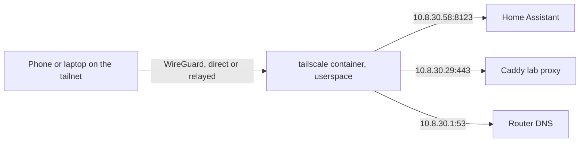

# Remote access with Tailscale

A separate Compose project on sfdockerhost1 (VM101, `10.8.30.29`) runs one
Tailscale node, `sfdockerhost1`, as a **subnet router**. Devices signed in to
the owner's tailnet reach these three addresses from anywhere, and nothing
else:

| Route | Target | Allowed by the policy |
|---|---|---|
| `10.8.30.58/32` | Home Assistant Green | TCP 8123 |
| `10.8.30.29/32` | Caddy (`*.lab.spiralfrenzy.com`) | TCP 80/443, UDP 443 |
| `10.8.30.1/32` | Core router DNS | TCP/UDP 53 |

No port is forwarded on the router and Home Assistant stays off the internet.
Tailscale is a split tunnel: phones send only these addresses through it.



## Why userspace networking

The VM's `/etc/docker/daemon.json` assigns Docker networks from
`100.64.0.0/20`, inside Tailscale's `100.64.0.0/10` address range. Kernel mode
would add a `tailscale0` interface, routes and iptables rules for that range
and could break traffic for the existing containers. In userspace mode
(`tailscaled --tun=userspace-networking`) it proxies connections itself: it creates no
interface, route or firewall rule, needs no TUN device, sudo or extra
capabilities, and runs with `cap_drop: [ALL]`. Host networking only lets it
hole-punch direct connections.

Targets see connections from `10.8.30.29`. Caddy's `LAB_ALLOWED_CIDRS`
already includes `10.0.0.0/8`, and Home Assistant has
`login_attempts_threshold: -1`, so failed remote logins never ban the shared
address (Uptime Kuma checks Home Assistant from the same host).

## Names and certificates

Split DNS sends `spiralfrenzy.com` lookups from tailnet devices to the router,
which answers `home.spiralfrenzy.com` with `10.8.30.58` and the lab names with
`10.8.30.29`. The usual URLs and certificates therefore work remotely:
`https://home.spiralfrenzy.com:8123` uses its public Let's Encrypt certificate,
and the lab sites need the homelab CA on the device, as on the LAN. If Android
Private DNS is set to a specific provider, it bypasses this; use Automatic.

## Admin console settings

These live in the owner's Tailscale account, not in this repository:

- Machines → `sfdockerhost1`: the three routes approved, key expiry disabled.
- Access controls: the contents of [`tailscale/policy.hujson`](../tailscale/policy.hujson),
  replacing the default allow-all policy. Widen it there, then add the route
  to `TS_ROUTES`.
- DNS: custom nameserver `10.8.30.1`, restricted to `spiralfrenzy.com`.

To give someone else access, invite them under **Users → Invite users**; they
sign in with their own identity and the policy's `autogroup:member` covers
them. Do not use **Share machine** instead: shared machines do not carry subnet
routes. They still need their own Home Assistant login, and the homelab CA for
the lab sites.

## Deploy and operate

Deployed and verified on 2026-10-31: node `sfdockerhost1` running with all
three routes approved and key expiry disabled, split DNS
`spiralfrenzy.com -> 10.8.30.1` delivered by the coordination server, and the
owner's Pixel connected directly. With Wi-Fi off, the owner opened
`https://home.spiralfrenzy.com:8123` in the browser and the Home Assistant app.

The node has no auth key. The compose file starts `tailscaled` itself rather
than the image's `containerboot`, which allows an interactive login only 60
seconds before exiting; the first deployment restarted 30 times that way, with
a new login URL each time. Now `tailscale up` waits as long as needed for the
owner to open its URL. The login then lives in the `tailscale_state` volume, and
later starts only reapply the hostname, routes and `--accept-dns=false`.

```sh
cd ~/GIT-REPOS/lab-status/tailscale
docker compose up -d
docker compose logs | grep -A2 'To authenticate'   # before the first login only
docker exec tailscale-tailscale-1 tailscale status
docker exec tailscale-tailscale-1 tailscale dns status --all   # split DNS routes
```

The first deployment ran from `~/tailscale-deploy-20261031` before this
project reached `main`. The Compose project name is fixed, so starting it from
the checkout reuses the same container and volume; remove the staging folder
afterwards.

To upgrade, change the pinned image tag and run `docker compose up -d`. To
revoke access, remove the machine in the admin console and run
`docker compose down -v`; deleting the volume forgets the node identity.
